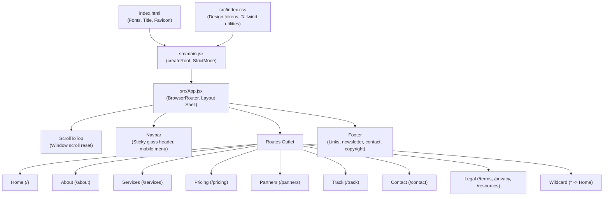

# PROJECT AUDIT: VEXARO COURIER SOLUTIONS

**Date**: 2026-11-17  
**Project**: Vexaro Courier Solutions Website Reconstruction  
**Path**: `C:\Users\HP5CD\Vexaro-Reconstruction\website`  
**Status**: Pre-Cleanup Architectural Assessment  
**Guiding Principle**: **STRICT ZERO-UI-CHANGE RULE** — Zero visual, layout, interaction, animation, styling, or functional modifications.

---

## 1. Executive Summary

The Vexaro Courier Solutions project is a high-fidelity website reconstruction consisting of 10 routes, complete responsive viewports (Desktop 1440px, Tablet 768px, Mobile 390px), custom design tokens, centralized mock databases, and interactive UI components.

The build succeeds with zero compile errors (`npm run build` completed in ~1.07s). However, an in-depth codebase audit reveals dead dependencies (`gsap`), unused template assets, an unimported boilerplate stylesheet (`App.css`), 32 ESLint violations (predominantly unneeded `React` imports under React 19 JSX transform, unused Lucide icon imports, and a Fast Refresh dual export in `StatCounter.jsx`), and opportunities to organize components into structured subdirectories (`layout/`, `sections/`, `common/`).

This document establishes the baseline audit before performing any safe refactoring.

---

## 2. Technology Stack & Dependencies

### Core Framework & Build Tools
| Technology | Version | Purpose | Usage Status |
| :--- | :--- | :--- | :--- |
| **React** | `^19.3.1` | Core UI library | Active (used across all 18 components/pages) |
| **React DOM** | `^19.3.1` | DOM renderer | Active (used in `src/main.jsx`) |
| **Vite** | `^8.3.6` | Build tool & dev server | Active |
| **React Router DOM** | `^7.18.5` | Client-side routing | Active (10 routes configured in `App.jsx`) |
| **Lucide React** | `^1.74.0` | Vector icon library | Active (used in 14 files) |
| **GSAP** | `^3.15.1` | Animation library | **INACTIVE (0 references across source code)** |
| **Tailwind CSS** | `^4.3.5` | CSS utility framework | Active (`@tailwindcss/vite` plugin) |
| **ESLint** | `^10.14.0` | Code linter | Active (`npm run lint` configuration) |

### Key Dependency Findings
1. **GSAP (`gsap`)**: Installed in `package.json` (`dependencies`), but has zero imports across all source files. The interactive counter animation was implemented using native browser `requestAnimationFrame` + cubic easing in `StatCounter.jsx`, and CSS keyframe animations in `index.css`.
   - *Recommendation*: Safely retain in `package.json` unless removal is explicitly desired, or remove to reduce install footprint if proven zero-risk. Keeping it causes no runtime bundle bloat since Vite tree-shakes unreferenced dependencies.
2. **Lucide React (`lucide-react`)**: Heavily utilized for UI icons, but multiple pages import unused icon primitives (e.g. `ShieldCheck`, `Zap`, `Globe`, `Radio`, `Headphones` in `Home.jsx`).
   - *Recommendation*: Safely clean up unreferenced named imports to reduce bundle size and satisfy ESLint.

---

## 3. Current Folder Structure

```text
Vexaro-Reconstruction/
├── analysis/                      # Architectural & reverse-engineering reports
│   ├── ASSET_MAP.md
│   ├── COMPONENT_MAP.md
│   ├── DESIGN_SYSTEM.md
│   ├── IMPLEMENTATION_PLAN.md
│   ├── INTERACTIONS.md
│   ├── SITE_MAP.md
│   └── VISUAL_QA_REPORT.md
├── capture/                       # Playwright reference and local captures
│   ├── live/                      # Original live website scraped assets & screenshots
│   └── local/                     # Local reconstruction verification screenshots
├── scripts/                       # Diagnostic, capture & comparison Node scripts
│   ├── audit-codebase.mjs
│   ├── capture-local.mjs
│   ├── compare-dimensions.mjs
│   └── inspect-bundle.mjs
└── website/                       # Application Root
    ├── index.html                 # HTML Entry Point
    ├── package.json               # Dependencies & scripts
    ├── vite.config.js             # Vite configuration
    ├── eslint.config.js           # ESLint configuration
    ├── public/                    # Static Assets (Served at root `/`)
    │   ├── assets/                # Mirror directory containing 28 original images
    │   ├── 24-7-support.png
    │   ├── amazon-shipping.png
    │   ├── aramex.png
    │   ├── client-ankit.png ... (5 client avatars)
    │   ├── dhl.png ... (9 courier partner logos)
    │   ├── favicon.svg            # Default Vite template icon (unused)
    │   ├── hero_background.png
    │   ├── icons.svg              # Boilerplate SVG sprite (unused)
    │   ├── logoxpress.png
    │   └── new-logo.png           # Primary Vexaro header/footer logo
    └── src/                       # React Source Code
        ├── main.jsx               # React DOM root render
        ├── App.jsx                # Router & shell layout
        ├── App.css                # 1-line empty comment (UNIMPORTED)
        ├── index.css              # 48.8 KB complete design tokens & Tailwind bundle
        ├── assets/                # Vite boilerplate templates (UNREFERENCED)
        │   ├── hero.png
        │   ├── react.svg
        │   └── vite.svg
        ├── components/            # Currently flat components folder
        │   ├── Footer.jsx
        │   ├── IconHelper.jsx
        │   ├── Navbar.jsx
        │   ├── PageHeader.jsx
        │   ├── ShipmentJourney.jsx
        │   ├── StatCounter.jsx
        │   └── TestimonialsSlider.jsx
        ├── data/
        │   └── siteData.js        # 560 lines of centralized content, menus, stats & FAQs
        ├── hooks/
        │   └── useMeta.js         # Document title & meta description updater
        └── pages/                 # 8 Page components
            ├── About.jsx
            ├── Contact.jsx
            ├── Home.jsx
            ├── Legal.jsx          # Dynamic component serving /terms, /privacy, /resources
            ├── Partners.jsx
            ├── Pricing.jsx
            ├── Services.jsx
            └── Track.jsx
```

---

## 4. Main Entry Points & Application Flow



---

## 5. Page and Component Relationships

| Page / Route | Path | Components Rendered | Data Sources |
| :--- | :--- | :--- | :--- |
| **Home** | `/` | `Navbar`, `StatCounter`, `ShipmentJourney`, `TestimonialsSlider`, `IconHelper`, `Footer` | `siteData.js` (`servicesData`, `keyMetrics`, `testimonials`, `whyChooseUs`, `networkHubs`) |
| **About** | `/about` | `Navbar`, `PageHeader`, `Footer` | `siteData.js` (`aboutStats`, `teamValues`, `infrastructureHighlights`) |
| **Services** | `/services` | `Navbar`, `PageHeader`, `IconHelper`, `Footer` | `siteData.js` (`servicesData`) |
| **Pricing** | `/pricing` | `Navbar`, `PageHeader`, `Footer` | `siteData.js` (`pricingPlans`, `pricingFaqs`) |
| **Partners** | `/partners` | `Navbar`, `PageHeader`, `Footer` | `siteData.js` (`partnerCategories`, `partnersList`) |
| **Track** | `/track` | `Navbar`, `PageHeader`, `Footer` | `siteData.js` (`trackingDatabase`, `statusBadges`) |
| **Contact** | `/contact` | `Navbar`, `PageHeader`, `Footer` | `siteData.js` (`siteConfig`, `branchOffices`, `inquiryTypes`) |
| **Terms of Service** | `/terms` | `Navbar`, `PageHeader`, `Footer` | `siteData.js` (`legalData.terms`) |
| **Privacy Policy** | `/privacy` | `Navbar`, `PageHeader`, `Footer` | `siteData.js` (`legalData.privacy`) |
| **Resources** | `/resources` | `Navbar`, `PageHeader`, `Footer` | `siteData.js` (`legalData.resources`) |

---

## 6. CSS Architecture & Styling System

1. **`src/index.css`**:
   - Single source of truth for styles (48,822 bytes).
   - Contains:
     - `@import` for Google Fonts: *Plus Jakarta Sans* (300 to 900) and *Inter* (300 to 700).
     - Global CSS variables (`--navy: #1a3a8f`, `--orange: #e06000`, `--cream: #fafbff`, `--light-blue: #f0f4ff`, `--charcoal: #1a202c`, etc.).
     - Utility styles: `.container-custom`, `.glass-panel`, `.card-hover`, `.gradient-navy`, `.gradient-orange`, `.gradient-duo`, `.section-padding`.
     - Custom keyframes: `@keyframes float`, `@keyframes pulse-ring`, `@keyframes shimmer`.
     - Custom scrollbar styling and Swiper slider styles (`.swiper`, `.swiper-wrapper`, `.swiper-slide`, `.swiper-pagination-bullet`).
   - **Crucial Rule**: `index.css` must NOT be modified or pruned, ensuring zero styling regressions.
2. **`src/App.css`**:
   - Only contains `/* App-specific custom overrides if needed */`.
   - Never imported in `main.jsx` or `App.jsx`.
   - **Status**: Completely dead boilerplate file from default Vite template.

---

## 7. Asset Organization & References

- **Live Images Recovered**: 28 distinct image assets placed in both `website/public/` and `website/public/assets/`.
- **Reference Pattern**:
  - Components and data currently reference `/image-name.png` (e.g. `/new-logo.png`, `/hero_background.png`).
  - Both `/assets/` and root `/` paths work seamlessly due to Vite public directory resolution.
- **Unused Assets Identified**:
  - `website/src/assets/hero.png` (13 KB template mockup, 0 references).
  - `website/src/assets/react.svg` (4 KB Vite React logo, 0 references).
  - `website/src/assets/vite.svg` (8.7 KB Vite logo, 0 references).
  - `website/public/favicon.svg` (Unused; `index.html` specifies `<link rel="icon" href="/new-logo.png" />`).
  - `website/public/icons.svg` (Unused Vite SVG sprite with bluesky/discord icons).

---

## 8. Code Quality, Duplication & Technical Issues

### 1. ESLint Violations (32 Total)
- **16x `no-unused-vars: 'React' is defined but never used`**:
  Under React 19 with the automatic JSX runtime (`@vitejs/plugin-react`), `import React from 'react'` is unnecessary unless named hooks (`useState`, `useEffect`) or the `React` namespace are used.
- **13x Unused Lucide Icons & variables**:
  - `src/pages/Home.jsx`: `ShieldCheck`, `Zap`, `MapPin`, `Headphones`, `Radio`, `Globe`, `Cpu`, `ChevronRight`.
  - `src/pages/Contact.jsx`: `AlertCircle`.
  - `src/pages/Legal.jsx`: `ArrowRight`.
  - `src/pages/Partners.jsx`: `ArrowRight`.
  - `src/pages/Pricing.jsx`: `ArrowRight`, `Zap`, and unused parameter `idx`.
- **1x React Hook Cascading Render Error in `src/components/Navbar.jsx`**:
  - `useEffect(() => { setMobileOpen(false); }, [location]);` causes `react-hooks/set-state-in-effect`. All mobile menu links already call `setMobileOpen(false)` on click; this effect is both redundant and triggers unnecessary cascading renders.
- **1x React Refresh Fast Refresh Error in `src/components/StatCounter.jsx`**:
  - `useCountUp` custom hook is exported from `StatCounter.jsx` alongside the component, violating `react-refresh/only-export-components`.

### 2. Code Duplication
- **Social Media Icons**: Inline SVGs for Facebook, Twitter/X, Instagram, and LinkedIn are duplicated between `Navbar.jsx` and `Footer.jsx`.

---

## 9. Safe Cleanup & Refactoring Recommendations

| # | Action Item | Risk Level | Expected Benefit |
| :--- | :--- | :--- | :--- |
| **1** | Extract `useCountUp` from `StatCounter.jsx` into `src/hooks/useCountUp.js` | **Zero Risk** | Fixes Fast Refresh ESLint error; adheres to React hook standards. |
| **2** | Organize components into logical subfolders (`layout/`, `sections/`, `common/`) OR maintain organized imports | **Zero Risk** | Clear mental model for future developers. |
| **3** | Remove unused imports across all pages and components (`React`, unused Lucide icons, unused params) | **Zero Risk** | Eliminates 30+ ESLint errors, reduces bundle size. |
| **4** | Fix `Navbar.jsx` mobile menu state handling | **Zero Risk** | Resolves React 19 `react-hooks/set-state-in-effect` warning. |
| **5** | Remove unreferenced template files (`App.css`, `src/assets/hero.png`, `src/assets/react.svg`, `src/assets/vite.svg`, `public/favicon.svg`, `public/icons.svg`) | **Zero Risk** | Eliminates confusion and cleans project repository. |
| **6** | Preserve `index.css` completely intact | **Zero Risk** | Guarantees 100% pixel-perfect zero UI/visual regression. |
| **7** | Verify production build & capture automated visual regression verification | **Zero Risk** | Confirms 100% parity before and after refactoring. |

---

## 10. Verification Plan

1. **Step 1**: Pre-refactoring build test (`npm run build`).
2. **Step 2**: Apply changes in incremental, verifiable steps.
3. **Step 3**: Re-run `npm run lint` and `npm run build` in `website/`.
4. **Step 4**: Run automated comparison script against live baseline screenshots to confirm exact 1.00x height and layout fidelity.
5. **Step 5**: Generate final `CLEANUP_REPORT.md` and `PROJECT_STRUCTURE.md`.
